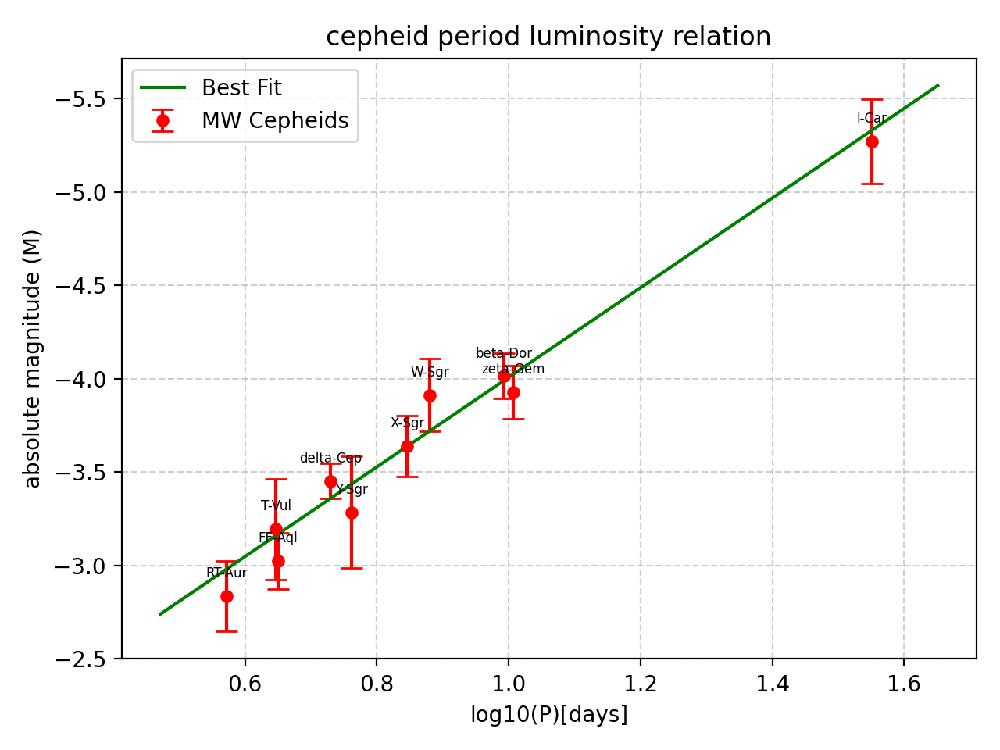
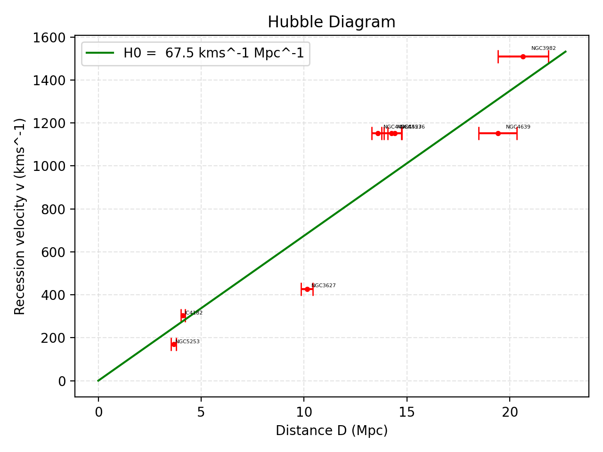

# Estimating the Hubble constant

An estimate of the Hubble constant from Cepheid variable stars and galaxy recession velocities, using only NumPy and Matplotlib. This was data-analysis coursework for MPhys Physics at the University of Southampton (December 2025). I wrote the analysis and the code by hand.

**Result:** H₀ = 67.5 ± 5.8 km/s/Mpc, consistent with the Planck 2018 value of 67.4 ± 0.5.

## Method

1. **Calibrate the period–luminosity relation.**
   - Data: 10 Milky Way Cepheids with parallax distances and extinction estimates.
   - Fit: weighted least squares, with full error propagation from parallax and extinction to absolute magnitude.
   - Slope: −2.401 ± 0.232 (reduced χ² = 0.535).
   - Fitting about log₁₀P = 0.845 instead of 0 takes the slope–intercept correlation from −0.970 to zero.
2. **Measure the distance to NGC 4527.**
   - Data: the calibrated relation applied to 22 of its Cepheids, after correcting for Milky Way extinction.
   - The scatter is larger than the quoted errors explain, so an intrinsic dispersion of 0.300 mag is added until the reduced χ² is close to 1.
   - Distance modulus: 30.768 ± 0.072 mag, which gives **14.24 ± 0.48 Mpc**.
3. **Estimate the Hubble constant.**
   - Data: NGC 4527 combined with seven more galaxies, each with a recession velocity and a distance.
   - The individual values range from 42 to 85 km/s/Mpc, so an intrinsic dispersion of 16.2 km/s/Mpc is fitted (reduced χ² = 1.0).
   - The weighted mean gives **H₀ = 67.5 ± 5.8 km/s/Mpc**.

The full derivations, error propagation and discussion are in `report.pdf`.

## Figures





## Running it

```
pip install numpy matplotlib
python The_Doctor.py
```

The script prints each step's fit results and saves `pl_relation.png` and `hubble_diagram.png`.

## Files

| File | Contents |
|---|---|
| `The_Doctor.py` | The whole analysis |
| `MW_Cepheids.dat` | Milky Way calibration Cepheids: parallax, period, magnitude, extinction |
| `ngc4527_cepheids.dat` | Cepheids in NGC 4527: name, log₁₀ period, apparent magnitude |
| `other_galaxies.dat` | Recession velocities and distances for seven more galaxies |
| `report.pdf` | The written report (7 pages) |

The data files were provided with the coursework.

**About the filename:** `The_Doctor.py` is named after Monster Energy's The Doctor, which got me through this analysis. It was crucial enough to count as a collaborator, so it earned an honourable mention as the name of the main file.
